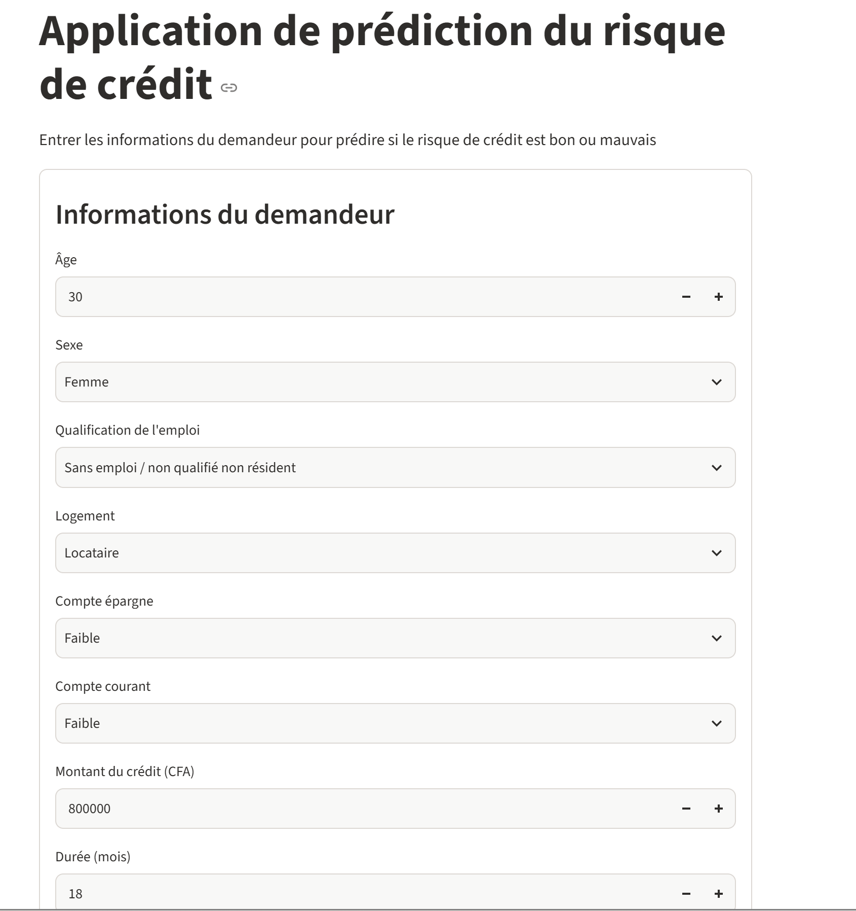
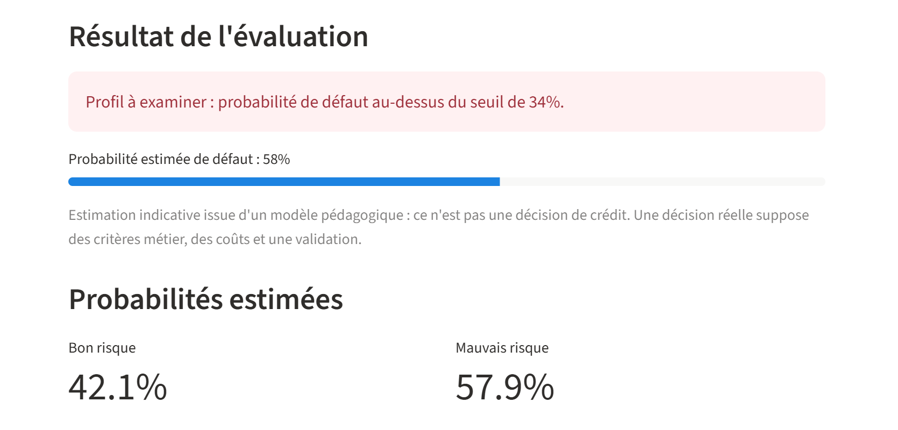
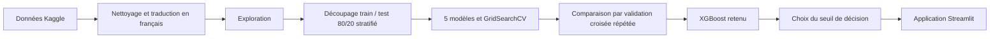

# 🏦 Credit Risk Intelligence

**Modélisation du risque de crédit bancaire : de l'analyse des données à une application déployée.**

[](https://credit-risk-intelligence-ml-bank.streamlit.app/)


Ce projet estime la **probabilité de défaut** d'une demande de crédit à partir du profil du demandeur. Il couvre toute la chaîne d'un projet de data science : préparation et contextualisation des données, exploration, comparaison de plusieurs modèles, choix raisonné d'un seuil de décision, puis mise en ligne d'une application.

👉 **[Essayer l'application](https://credit-risk-intelligence-ml-bank.streamlit.app/)**

> ⚠️ **Note:** Les données sont anciennes (années 1990, Allemagne) et le jeu est petit.  Voir la section [Limites](#limites-et-précautions).

---

## Sommaire

1. [Aperçu](#aperçu)
2. [Contexte et objectifs](#contexte-et-objectifs)
3. [Les données](#les-données)
4. [Démarche](#démarche)
5. [Ce que montre l'exploration](#ce-que-montre-lexploration)
6. [Modélisation et résultats](#modélisation-et-résultats)
7. [Choix du seuil de décision](#choix-du-seuil-de-décision)
8. [Variables importantes](#variables-importantes)
9. [L'application Streamlit](#lapplication-streamlit)
10. [Installation et exécution](#installation-et-exécution)
11. [Structure du dépôt](#structure-du-dépôt)
12. [Limites et précautions](#limites-et-précautions)
13. [Pistes d'amélioration](#pistes-damélioration)
14. [Auteur](#auteur)

---

## Aperçu

| Saisie du dossier | Résultat de l'évaluation |
|---|---|
|  |  |

---

## Contexte et objectifs

Dans une banque, accorder un crédit à un client qui ne rembourse pas coûte beaucoup plus cher que refuser un bon client. Un modèle de scoring aide à trier les dossiers selon leur risque.

**Objectifs du projet**

- construire un modèle qui estime la probabilité qu'un demandeur soit un « mauvais payeur » ;
- l'évaluer avec des métriques adaptées au risque de crédit (AUC, Gini, KS, rappel), et pas seulement l'accuracy ;
- raisonner le **seuil de décision** au lieu de garder 0,5 par défaut ;
- adapter le jeu de données à un contexte **francophone** (libellés en français, montants en FCFA) ;
- déployer le résultat dans une application utilisable.

---

## Les données

**Source** : *German Credit Dataset* (Kaggle), version simplifiée du jeu [Statlog German Credit Data](https://archive.ics.uci.edu/dataset/144/statlog+german+credit+data) de l'UCI Machine Learning Repository : 1 000 clients, 9 variables explicatives et la variable cible `Risk`.

| Variable (adaptée en français) | Description | Type |
|---|---|---|
| `age` | Âge du demandeur | numérique |
| `sexe` | Homme / Femme | catégorielle |
| `qualification_emploi` | 0 : sans emploi ou non qualifié non résident, 1 : non qualifié résident, 2 : qualifié, 3 : très qualifié / cadre | ordinale |
| `logement` | Propriétaire / Locataire / Logé gratuitement | catégorielle |
| `compte_epargne` | Niveau d'épargne : faible, modérée, assez élevée, élevée | ordinale |
| `compte_courant` | Niveau du compte courant : faible, modéré, élevé | ordinale |
| `montant_credit` | Montant du crédit demandé (converti en FCFA) | numérique |
| `duree` | Durée du crédit en mois | numérique |
| `objet_credit` | Objet du crédit (automobile, éducation, etc.) | catégorielle |
| `risque` | **Cible** : « Bon » (a remboursé) ou « Mauvais » (défaut) | binaire |

**Adaptations réalisées**

- Traduction des noms de colonnes et des modalités en français.
- Cible encodée **Bon = 0, Mauvais = 1** : la classe positive est l'événement à détecter, le défaut.
- **Conversion des montants en FCFA** au taux fixe issu des parités officielles (1 € = 1,95583 DM et 1 € = 655,957 FCFA), soit **1 DM ≈ 335,39 FCFA**. C'est une conversion nominale, à titre illustratif : elle ne tient pas compte du pouvoir d'achat actuel.
- Valeurs manquantes : voir [ci-dessous](#valeurs-manquantes).

### Valeurs manquantes

`compte_epargne` (183 valeurs) et `compte_courant` (394 valeurs) contiennent des valeurs manquantes. Elles correspondent à des clients **sans compte renseigné**, et non à des oublis au hasard. L'analyse a montré que ces clients se comportent différemment :

| Compte courant | Effectif | Taux de « Mauvais » |
|---|---|---|
| Faible | 274 | 49,3 % |
| Modéré | 269 | 39,0 % |
| Élevé | 63 | 22,2 % |
| **Aucun compte / inconnu** | 394 | **11,7 %** |

Supprimer ces lignes fausse l'échantillon : la part de mauvais payeurs passe de **30 % à 44,3 %**. Le modèle final a pourtant été entraîné sur les **522 clients sans valeur manquante** (291 « Bon », 231 « Mauvais »), choix assumé pour avancer, et documenté comme limite. Le traitement des manquants comme catégorie à part est la première piste d'amélioration.

---

## Démarche



**Principes méthodologiques suivis**

- Découpage **stratifié** 80/20 (`stratify=y`, `random_state=42`) : environ 417 clients pour l'entraînement et 105 pour le test (59 « Bon », 46 « Mauvais »).
- Réglage des hyperparamètres par `GridSearchCV` avec validation croisée stratifiée à 5 plis, **critère : AUC**.
- Le modèle est choisi sur la **validation croisée**, jamais sur le jeu de test, qui sert uniquement de vérification finale.
- Le seuil de décision est choisi sur les prédictions « hors pli » de l'entraînement, pas sur le test.

---

## Ce que montre l'exploration

- **Cible déséquilibrée** : environ 30 % de mauvais payeurs dans le jeu complet.
- **La durée du crédit est la variable numérique la plus discriminante** : médiane d'environ 24 mois pour les « Mauvais » contre environ 15 mois pour les « Bon ».
- **Le montant** a un effet plus modéré (les très gros crédits sont plus fréquents chez les « Mauvais »), et **l'âge** n'apporte presque rien à lui seul.
- **Le niveau d'épargne suit un gradient net** (jeu complet) :

| Compte d'épargne | Effectif | Taux de « Mauvais » |
|---|---|---|
| Faible | 603 | 36,0 % |
| Modérée | 103 | 33,0 % |
| Assez élevée | 63 | 17,5 % |
| Élevée | 48 | 12,5 % |
| Aucun compte / inconnu | 183 | 17,5 % |

- **Valeurs extrêmes** (gros montants, longues durées, âges élevés) : ce sont de vrais clients, pas des erreurs de saisie. Elles ont été conservées.

---

## Modélisation et résultats

Cinq modèles ont été comparés : arbre de décision, Random Forest, Extra Trees, **XGBoost** et une régression logistique de référence.

| Modèle | AUC, validation croisée répétée 5×5 | AUC test | Gini test | KS test |
|---|---|---|---|---|
| **XGBoost** | **0,674 ± 0,053** | 0,707 | 0,413 | 0,363 |
| Random Forest | 0,672 ± 0,063 | 0,697 | 0,394 | 0,378 |
| Extra Trees | 0,658 ± 0,053 | 0,724 | 0,449 | 0,443 |
| Régression logistique | 0,652 ± 0,063 | 0,698 | 0,396 | 0,368 |
| Arbre de décision | 0,622 ± 0,053 | 0,673 | 0,346 | 0,385 |

**Lecture des résultats**

- **L'arbre de décision seul est le plus faible**, comme on s'y attend pour un modèle instable.
- **XGBoost, Random Forest, Extra Trees et la régression logistique sont proches** : l'écart entre le meilleur et le dernier (0,022) est inférieur à la variabilité d'un découpage à l'autre (≈ 0,05 à 0,06). **Ils ne sont pas statistiquement distinguables.**
- **XGBoost est retenu** car il a la meilleure AUC moyenne en validation croisée répétée. L'écart avec Random Forest (0,002) est négligeable.
- L'ordre des modèles sur le **jeu de test** (105 clients) diffère de celui de la validation croisée : le test est trop petit pour départager des modèles aussi proches. Il est donné à titre indicatif.
- Le **Gini** n'est que l'AUC réécrite (`2 × AUC − 1`), dans le langage des équipes risque en banque.
- Le niveau global reste **modeste** (AUC ≈ 0,67 à 0,70), ce qui s'explique par la petite taille de l'échantillon et le nombre limité de variables.

> La régression logistique a été conservée comme référence, avec un encodage simple des variables catégorielles. Un encodage plus adapté pourrait légèrement améliorer sa performance.

---

## Choix du seuil de décision

Le modèle produit une **probabilité de défaut**. Pour la transformer en décision, il faut un seuil : à partir de quelle probabilité signale-t-on un dossier ?

**Première approche : minimiser un coût** (5 pour un mauvais payeur accepté, 1 pour un bon client refusé, convention de la documentation du jeu d'origine). Elle donne un résultat **dégénéré** : un seuil de 0,09, soit un modèle qui refuse 58 bons clients sur 59, avec un coût équivalent à celui de « refuser tous les dossiers ». Avec un ratio de 5 pour 1, un client n'est accepté que si sa probabilité de défaut est inférieure à environ 17 %, et seulement 8,2 % des clients passent sous ce niveau. Le pouvoir de séparation du modèle ne permet donc pas d'exploiter cette matrice de coûts. Le seuil optimal est d'ailleurs instable : 0,38 pour un ratio 2/1, 0,09 dès 3/1.

**Approche retenue : une règle de gestion explicite.** Hypothèse : *détecter au moins 75 % des mauvais payeurs*. Le seuil retenu est le plus élevé qui respecte cette contrainte sur les prédictions hors pli de l'entraînement : **0,34**.

Résultat sur le jeu de test (105 clients) :

| Seuil | Mauvais payeurs détectés | Bons clients refusés | Dossiers signalés |
|---|---|---|---|
| 0,50 (par défaut) | 27 / 46 (59 %) | 19 / 59 (32 %) | 46 / 105 (44 %) |
| **0,34 (retenu)** | **38 / 46 (83 %)** | **33 / 59 (56 %)** | **71 / 105 (68 %)** |

**Conclusion** : le modèle sépare mieux que le hasard (à 56 % de bons clients refusés, un tri aléatoire détecterait 56 % des défauts, contre 83 % ici), mais pas assez pour un usage opérationnel : détecter l'essentiel des défauts impose de refuser plus de la moitié des bons clients, et seul un dossier signalé sur deux (54 %) est réellement un mauvais payeur. Le seuil de 0,34 illustre le compromis. Dans une vraie banque, il serait fixé à partir des coûts réels.

---

## Variables importantes

L'importance (gain moyen par découpage) du modèle XGBoost place la **durée du crédit largement en tête**. Les autres variables, qualification de l'emploi, âge, montant, comptes d'épargne et courant, sexe et logement, ont des importances proches les unes des autres.

La régression logistique va dans le même sens : une hausse d'un écart-type de la durée multiplie les odds de défaut par environ 1,9, toutes choses égales par ailleurs. Cela rejoint l'exploration.

> Ces importances indiquent quelles variables sert le modèle, pas dans quel sens ni pourquoi. Elles sont instables sur un petit échantillon et ne prouvent aucune causalité.

---

## L'application Streamlit

**[credit-risk-intelligence-ml-bank.streamlit.app](https://credit-risk-intelligence-ml-bank.streamlit.app/)**

- **Formulaire de saisie** : âge, sexe, qualification de l'emploi, logement, comptes d'épargne et courant, montant (FCFA) et durée. L'âge et la durée sont bornés à la plage des données d'entraînement, et le montant a un minimum de 85 000 FCFA.
- **Résultat** : probabilité estimée de défaut (barre de progression) et probabilités « bon » / « mauvais ».
- **Message de décision** : profil « à examiner » si la probabilité dépasse le seuil de 34 %, « plutôt favorable » sinon.
- **Mise en garde** affichée avec le résultat : estimation indicative, pas une décision de crédit.

**Exemples de profils testés** (modèle en ligne)

| Profil | Probabilité de défaut | Verdict (seuil 34 %) |
|---|---|---|
| 32 ans, propriétaire, épargne assez élevée, compte courant élevé, 800 000 FCFA, 12 mois | 12 % | plutôt favorable |
| 30 ans, locataire, épargne faible, compte courant élevé, 800 000 FCFA, 21 mois | 40 % | à examiner |
| Compte courant faible, 800 000 FCFA, 48 mois | 91 % | à examiner |

L'ordre des profils est cohérent avec l'analyse (risque qui augmente avec la durée et la faiblesse des comptes). Les valeurs exactes ne doivent pas être lues au pied de la lettre.

---

## Installation et exécution

```bash
# 1. Cloner le dépôt
git clone https://github.com/mdtech-ai/NOM-DU-DEPOT.git
cd NOM-DU-DEPOT

# 2. Créer et activer un environnement virtuel
python -m venv .venv
.venv\Scripts\activate          # Windows
# source .venv/bin/activate     # macOS / Linux

# 3. Installer les dépendances
pip install -r requirements.txt

# 4. Lancer l'application
streamlit run app.py
```

Le modèle (`.pkl`) et les encodeurs doivent se trouver dans le même dossier que `app.py`. Les versions de `scikit-learn` et `xgboost` de `requirements.txt` doivent être respectées : un modèle sauvegardé avec une version peut ne pas se charger avec une autre.

---

## Structure du dépôt

```text
.
├── app.py                      # Application Streamlit
├── requirements.txt            # Dépendances (versions figées)
├── xgb_credit_model.pkl        # Modèle XGBoost entraîné
├── target_encoder.pkl          # Encodeur de la cible (Bon = 0, Mauvais = 1)
├── sexe_encoder.pkl            # Encodeurs des variables catégorielles
├── logement_encoder.pkl
├── compte_epargne_encoder.pkl
├── compte_courant_encoder.pkl
├── notebooks/                  # Analyse et modélisation 
├── docs/images/                # Captures d'écran du README
└── README.md
```

---

## Limites et précautions

- **Petit échantillon** : 522 clients après suppression des valeurs manquantes (417 pour l'entraînement, 105 pour le test). Les métriques du test sont instables et les probabilités peu précises.
- **Valeurs manquantes supprimées** : cela retire les clients sans compte renseigné (dont le profil de risque est très différent) et fait passer la part de mauvais payeurs de 30 % à 44 %. Les probabilités affichées ne sont donc **pas** de vraies probabilités de défaut pour un portefeuille réel.
- **Données anciennes et étrangères** : clients allemands des années 1990. Les montants convertis en FCFA ne reflètent pas le marché actuel de l'Afrique de l'Ouest.
- **Peu de variables** : pas d'historique de crédit ni de revenus, ce qui limite le signal disponible.
- **Pouvoir de séparation modeste** (AUC ≈ 0,67) : même avec le seuil retenu, plus de la moitié des bons clients sont signalés.
- **Choix du seuil** : il dépend d'une hypothèse de gestion (75 % des défauts détectés), pas de coûts réels.
- **Variable sensible** : le **sexe** figure parmi les variables du modèle. Dans un usage réel, son emploi dans une décision de crédit serait encadré, voire interdit, selon les juridictions. Il est conservé ici à titre pédagogique.
- **Prédiction ≠ décision** : le modèle estime un risque. Une décision de crédit suppose aussi des critères métier, des coûts et une validation.
- **Pas de calibration** des probabilités, et variable `objet_credit` non utilisée dans le modèle final.

---

## Pistes d'amélioration

1. **Réintégrer les clients sans compte** (catégorie « Aucun compte / inconnu ») et comparer l'AUC avec les 522 clients actuels.
2. **Réentraîner sans la variable `sexe`** et mesurer la perte de performance.
3. **Encodage adapté pour la régression logistique** (ordinal explicite pour les comptes, one-hot pour les autres variables).
4. **Calibrer les probabilités** pour qu'elles soient interprétables.
5. **Expliquer chaque décision** avec SHAP.
6. **Analyse de portefeuille** : importer un fichier CSV de plusieurs dossiers et obtenir la part de dossiers signalés.
7. **Page de performance du modèle** dans l'application (AUC, matrice de confusion, limites).
8. Tester d'autres jeux de données plus récents ou mieux adaptés au contexte ouest-africain.

---

## Auteur

**Mamadou DIALLO** : diplômé en ingénierie IA et Big Data (ESP-UCAD, Dakar), à la recherche d'un premier poste en Data Science et Machine Learning, avec un intérêt marqué pour le secteur bancaire.

- GitHub : [github.com/mdtech-ai](https://github.com/mdtech-ai)
- LinkedIn : [VOTRE-PROFIL](https://www.linkedin.com/in/VOTRE-PROFIL)

*Données : Statlog (German Credit Data), UCI Machine Learning Repository (Hans Hofmann, Université de Hambourg).*
